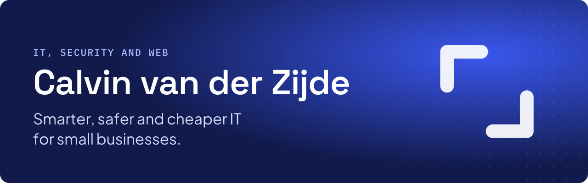

 

I'm self-taught: no degree, plenty of curiosity, and a lot of things that had to break first.

These days I run my own servers, build my own tools, and don't recommend anything I haven't tested myself. What I learn along the way ends up in the [Lab](https://cvdz.digital/en/lab/) and [knowledge base](https://cvdz.digital/en/knowledge/), free for anyone to read.

### Toolbox

| | |
|---|---|
| **Infrastructure** | Proxmox · OPNsense · WireGuard · nginx · Linux |
| **Web** | Astro · MedusaJS · Tailwind CSS · TypeScript |
| **Security** | SPF, DKIM, DMARC · Security headers · CSP · 2FA |
| **AI and automation** | Claude · Codex · Gemini · Custom scripts |

### Get in touch

[cvdz.digital](https://cvdz.digital/en/) · [Free tools](https://cvdz.digital/en/tools/) · [info@cvdz.digital](mailto:info@cvdz.digital)
