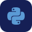
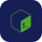
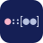

# Hi, I'm Calvin

### Self-taught IT specialist from the Netherlands. From bare metal to the browser.

- **Infrastructure:** I run my own servers and networks. Nothing gets recommended until it has run there first.
- **Software:** websites, webshops and tools, built to stay fast and easy to maintain.
- **Security:** part of how everything gets built, from the network up to the application.
- **Automation and AI:** taking repetitive work off people's hands, with a critical eye on the hype.
- **Business:** [cvdz.digital](https://cvdz.digital/en/), smarter, safer and cheaper IT for small businesses.
- **Free to use:** [tools](https://cvdz.digital/en/tools/), the [Lab](https://cvdz.digital/en/lab/) and a [knowledge base](https://cvdz.digital/en/knowledge/) in plain language.
- **Contact:** [info@cvdz.digital](mailto:info@cvdz.digital)

<h2 align="center">Tech stack</h2>

  
  
  
  
  
  
  

  
  
  
  
  

  
  
  
  

  
  
  
  

